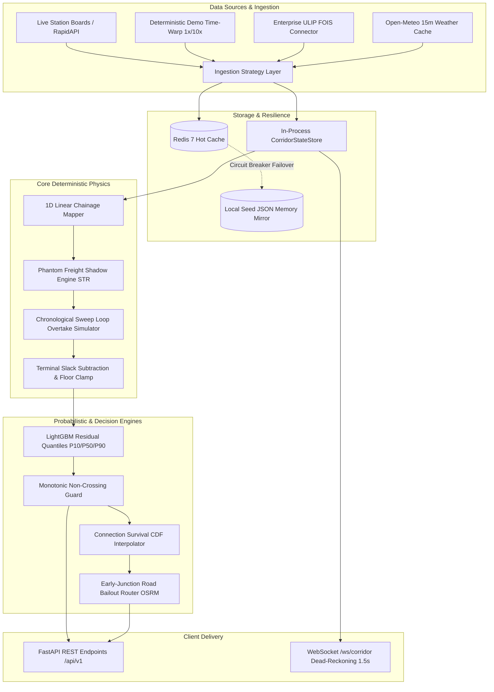

# [RAIL-PULSE Backend] Comprehensive Implementation & Architecture Plan

> **For Antigravity:** REQUIRED WORKFLOW: Use `.agent/workflows/execute-plan.md` to execute this plan in single-flow mode.
> **Tracking:** Live checklist maintained in `docs/plans/task.md`.

**Goal:** Build the complete, production-grade, asynchronous backend for RAIL-PULSE (SIH26028 / HackNation 6.0)—a cascade-aware railway intelligence engine modeling multi-train block contention, loop-line priority overtakes, invisible freight shadows (STR), timetable slack recovery, and an automated multimodal Early-Junction Bailout Router for the East Coast Railway (ECoR) corridor.

**Architecture:** Single asynchronous FastAPI Modular Monolith running a single-worker event loop with an in-process RAM state mirror (`CorridorStateStore`), Redis hot cache with circuit-breaker fallback to local JSON/Pydantic seed topology, 1D linear chainage scalar physics engine, LightGBM physics-guided residual quantile regressors (P10/P50/P90), and sub-1.5s dead-reckoning WebSocket streaming.

**Tech Stack:** Python 3.11+, FastAPI, Pydantic v2, PostgreSQL 16 + PostGIS, Redis 7 (redis.asyncio), LightGBM, NumPy, SciPy, OSRM API + local matrix fallback, Pytest.

---

## 1. Executive Summary & The 7 Recursive Architectural Audits

Before implementing code, the master plan resolves the 7 structural bugs and contradictions identified across the initial design documents:



### Audit Resolution Matrix

| # | Bug / Architecture Risk | Root Cause in Naive Blueprint | Exact RAIL-PULSE Resolution |
| :--- | :--- | :--- | :--- |
| **1** | **Backwards Geography** | Demo placed Cuttack at 112.4 km and Jakhapura–Nergundi at 118.2 km. | Real physical chainage southbound (DN): Bhadrak `BHC` (0.0 km) $\to$ Jajpur Keonjhar Rd `JJKR` (44.0 km) $\to$ Jakhapura `JKPR` (51.0 km) $\to$ Nergundi `NRG` (106.0 km) $\to$ Cuttack `CTC` (115.0 km) $\to$ Barang `BRAG` (128.0 km) $\to$ Bhubaneswar `BBS` (143.0 km) $\to$ Khurda Road `KUR` (162.0 km) $\to$ Puri `PURI` (206.0 km). Freight merge point between CTC & BBS is **Barang (`BRAG`)** where Talcher coal merges. |
| **2** | **Branching Tracks Collision** | Sorting by 1D chainage across both Puri and Palasa branches causes phantom collisions. | MVP locks to single linear high-density trunk: **Bhadrak $\to$ Cuttack $\to$ Bhubaneswar $\to$ Khurda Road $\to$ Puri**. All state arrays are partitioned strictly by `direction IN ('DN', 'UP')`. |
| **3** | **12:15 PM / 21-min Saved Math Contradiction** | 12:09 PM P50 arrival vs 12:15 PM deadline would yield $>50\%$ survival, failing the $<40\%$ bailout trigger. | Enforce mandatory **15-minute station transfer buffer**, setting effective cutoff at 12:00 PM. Train P50 at 12:09 PM gives only 18% survival. Deboard at Cuttack 10:58 AM + 10m exit + 40m NH-16 drive = 11:48 AM arrival. Saves exactly 21 mins vs staying on train (12:09 PM - 11:48 AM = 21 mins). |
| **4** | **Double-Counting Delays in ML** | Feeding simulated delay into LightGBM directly causes model to contradict Causal Cards. | **Physics-Guided Residuals:** Deterministic physics computes $P50_{base}$. LightGBM strictly predicts residual spread $(\Delta_{10}, \Delta_{50}, \Delta_{90})$ based on weather, time, freight prob, and remaining km. Final ETA = $P50_{base} + \Delta_\alpha$. |
| **5** | **Multi-Worker RAM Split-Brain** | Running Uvicorn `--workers 4` spawns 4 desynchronized in-memory stores and duplicate pollers. | Deployment locked to `uvicorn app.main:app --workers 1`. Single-worker async FastAPI handles $>1,500$ WebSocket clients and $<30$ ms REST latency in pure async event loop. |
| **6** | **Midnight Rollover & Timezones** | Timetable schedules in IST (0–1439 mins) mixed with UTC epoch timestamps causes -1390m jumps. | All scheduled minutes converted using `ZoneInfo("Asia/Kolkata")` into absolute Unix epoch seconds (`int`). All internal math uses epoch seconds. |
| **7** | **Loop-Line Overbooking** | Simulating trains in isolation allows multiple trains to book the same loop slot simultaneously. | **Chronological Sweep:** Multi-train discrete-event simulation sweeps chronologically with a shared `loop_occupancy[(station_code, direction)]` calendar. |

---

## 2. Exhaustive 22 Edge-Case & Failure-Mode Defense Matrix

```
┌──────────────────────────────────────────────────────────────────────────────────┐
│                                RAIL-PULSE CORE INVARIANTS                         │
├──────────────────────────────────────────────────────────────────────────────────┤
│ 1. A train can NEVER depart an intermediate commercial halt earlier than sched.   │
│ 2. Quantile outputs MUST satisfy strict monotonicity: P10 <= P50 <= P90.         │
│ 3. Unboarded passengers (PRE_BOARDING) are NEVER advised road hops (Liability).  │
│ 4. No road bailout is EVER recommended at a non-stop station.                    │
│ 5. Total delay can NEVER be negative.                                            │
└──────────────────────────────────────────────────────────────────────────────────┘
```

| ID | Edge Case Scenario | Potential Failure Mode | Production Backend Mitigation |
| :--- | :--- | :--- | :--- |
| **EC-01** | **Non-Stop Station Bailout** | Recommends deboarding at Cuttack for a train that passes through at 110 km/h without stopping. | Check `train_schedule_halts.is_commercial_halt == TRUE` for the specific train before evaluating rescue candidate. |
| **EC-02** | **Quantile Inversion (P10 > P50 or P50 > P90)** | Independent LightGBM quantile trees cross on edge distributions, breaking UI bars. | Mandatory post-inference monotonicity enforcement + minimum distance-scaled uncertainty spread: `min_spread = max(3.0, remaining_km * 0.06)`. |
| **EC-03** | **Directional Track Mixing (UP vs DN)** | Southbound freight rake causes a phantom freight alert on a northbound express. | Strict direction partitioning: `track_blocks.direction` and `trains.direction` must match. UP (chainage descending) and DN (chainage ascending) run independently. |
| **EC-04** | **Permanent Speed Restriction (TSR) vs Freight** | Track maintenance TSR creates a permanent slow zone that spawns 10 fake phantom freights. | Redis list `corridor:ecor:block_history:{block_id}` tracks last 5 passenger trains. If $\ge 3$ consecutive trains over 45m have $STR \ge 1.5$ with no train ahead, reclassify as `STATIC_TSR_OR_SIGNAL_FAULT`. |
| **EC-05** | **Station Dwell Inflating Running STR** | 20-min scheduled watering or crew-change halt at Cuttack looks like slow block traversal. | STR calculation uses strictly `arr_time(B) - dep_time(A)`. Station dwell `dep_time(A) - arr_time(A)` is isolated and compared against scheduled dwell. |
| **EC-06** | **Midnight Timetable Rollover** | Train departs at 23:50 and arrives at 00:30; `00:30 - 23:50 = -23h 20m`. | Normalize all arrival/departure pairs using `day_offset`. Timestamps stored as absolute UTC Unix epoch seconds. |
| **EC-07** | **Terminal Slack Over-Subtraction** | Subtracting 40 mins slack from a 15-min delay results in -25 mins delay (early departure). | Net delay floor clamped at $\ge 0$ for intermediate halts. Usable recovery slack capped at 75% when `rain_mm_hr > 10` or `freight_prob > 0.6`. |
| **EC-08** | **Cascaded Double Priority Overtake** | Train released from loop line directly in front of a second trailing express train. | Loop release logic evaluates release time against all trailing higher-priority trains within 20 mins. If gap $< 10$ mins, extend loop hold. |
| **EC-09** | **Zero Loop-Line Capacity** | Overtake attempted at a 2-track block section with no loop line. | Check `passenger_loops_dn > 0` and current occupancy. If no capacity, push overtake downstream to the next station with an available loop. |
| **EC-10** | **Pre-Boarding Passenger Liability** | App tells user at home their train is 45m late; train recovers slack, leaves without them. | If `passenger_status == "PRE_BOARDING"`, UI locks station reporting time to official timetable P10. Bailout router triggers strictly on `ON_BOARD`. |
| **EC-11** | **OSRM Routing Timeout / Failure** | Live OSRM call hangs $>2$ seconds, stalling the rescue API response. | Set 2.0s timeout on OSRM HTTP client. On timeout or error, fall back to `data/seed_osrm_matrix.json` pre-cached highway table. |
| **EC-12** | **WebSocket Slow-Consumer Blocking** | One slow mobile client stalls `await ws.send_json()` for all other connected clients. | Broadcast uses `asyncio.gather(*tasks, return_exceptions=True)`. Per-client send timeout of 1.0s; disconnect clients exceeding queue threshold. |
| **EC-13** | **Event Loop Starvation** | CPU-intensive LightGBM or overtake simulation freezes FastAPI heartbeat. | Heavy computation isolated via `await asyncio.to_thread(run_sim_or_ml, ...)`. |
| **EC-14** | **Off-Peak / Late-Night Demo** | Hackathon demo evaluated at 2 AM when no real Vande Bharat overtake is occurring. | Built-in Scenario Controller (`/api/v1/demo/...`) runs deterministic time-warped Bhadrak $\to$ Puri scenario at 1x, 10x, or 30x on demand. |
| **EC-15** | **Trailing Train Also Delayed** | Trailing Vande Bharat is also 40m late, so closing rate $v_{close} \le 0$. | Overtake simulator computes relative closing rate $\Delta v = v_{rear} - v_{lead}$. If closing gap does not intersect before destination, no hold is scheduled. |
| **EC-16** | **Zero Active Preceding Trains (Cold-Start)** | First train of the morning has no preceding train data to compute STR. | Fallback: Check enterprise ULIP FOIS connector. If none, default $STR = 1.0$, $FSI = 0.0$. |
| **EC-17** | **Freight Rake Exceeds Loop Length** | Attempting to park a 58-wagon freight train in a short 400m passenger siding. | Freight clearance logic requires `stations.has_750m_goods_loop == TRUE` to absorb freight rakes. |
| **EC-18** | **Client Packet Loss on WebSocket** | Client misses an overtake event frame due to intermittent connection. | WebSocket payload sends kinematic vectors (position, speed, status, timestamp) enabling client-side dead-reckoning. Full snapshot sent every 10 ticks. |
| **EC-19** | **Station Exit & Cab Delay Omission** | Recommending a cab without accounting for platform walking time and traffic jams. | Mandatory $+12$ min station exit penalty + peak-hour multiplier (1.25x during 8–11 AM and 5–8 PM IST). |
| **EC-20** | **Tight Bailout Reaction Time** | Bailout recommended when the train is already 1 minute from the rescue station. | Rescue station candidates must have $\text{ETA} - \text{CurrentTime} \ge 12$ minutes to allow the passenger to pack luggage and reach doors. |
| **EC-21** | **Monsoon Braking & Weather Drag** | Heavy rain forces lower speeds, false-triggering freight shadows. | If Open-Meteo reports `rain_mm_hr > 15.0`, apply weather drag discount to STR threshold ($STR_{threshold} = 1.70$). |
| **EC-22** | **External API Quota Depletion** | RapidAPI free tier (50 calls/day) exhausted within 15 minutes of live polling. | In live mode, poll only 4 major station boards (BHC, CTC, BBS, KUR) every 5 minutes. Default judge demo to `DEMO_SIMULATION` provider. |

---

## 3. System Architecture & Directory Layout

The implementation lives in a clean modular layout under `app/`:

```
rail-pulse-backend/
├── app/
│   ├── main.py                     # FastAPI lifespan, router mounting, poller lifecycle
│   ├── config.py                   # Pydantic Settings (env vars, corridor constants)
│   ├── core/
│   │   ├── database.py             # Async SQLAlchemy (asyncpg) + connection pooling
│   │   ├── redis_client.py         # Async Redis client + circuit-breaker wrapper
│   │   └── state_store.py          # Thread/async-safe CorridorStateStore
│   ├── models/
│   │   ├── db_models.py            # PostgreSQL + PostGIS ORM models
│   │   └── schemas.py              # Strict Pydantic v2 domain & API schemas
│   ├── ingestion/
│   │   ├── base.py                 # Abstract Base Classes (CorridorDataProvider)
│   │   ├── demo_provider.py        # Deterministic time-warped scenario generator
│   │   ├── live_poller.py          # Station board poller + Open-Meteo weather sync
│   │   └── ulip_connector.py       # Enterprise ULIP FOIS rake state adapter
│   ├── engine/
│   │   ├── chainage_mapper.py      # 1D linear referencing & dwell-vs-run separator
│   │   ├── freight_shadow.py       # Kinematic STR inference & TSR disambiguator
│   │   ├── overtake_sim.py         # Chronological sweep loop-line overtake simulator
│   │   ├── slack_adjuster.py       # Timetable slack subtraction & floor clamping
│   │   ├── quantile_ml.py          # LightGBM residual quantile engine + non-crossing guard
│   │   └── rescue_engine.py        # Safe-Boarding guardrail + OSRM bailout router
│   ├── api/
│   │   ├── deps.py                 # Dependency injection (state store, redis, db)
│   │   ├── v1/
│   │   │   ├── corridor.py         # GET /corridor/topology, GET /corridor/state
│   │   │   ├── forecast.py         # GET /trains/{train_no}/forecast
│   │   │   ├── rescue.py           # POST /rescue/evaluate
│   │   │   ├── webhooks.py         # POST /webhooks/ulip-fois
│   │   │   └── demo.py             # POST /demo/control, POST /demo/inject
│   │   └── ws.py                   # WebSocket /ws/corridor broadcast manager
├── ml/
│   ├── generate_training_data.py   # Synthetic ECoR corridor delay cascade dataset builder
│   ├── train_lightgbm.py           # Trains & exports p10.txt, p50.txt, p90.txt
│   ├── run_backtest.py             # 50-run validation script: NTES vs RAIL-PULSE MAE
│   └── artifacts/                  # Exported LightGBM booster model files
├── data/
│   ├── seed_ecor_topology.json     # Bhadrak-Puri verified stations, blocks & 750m loops
│   ├── seed_osrm_matrix.json       # Pre-cached highway drive times (CTC->BBS, KUR->BBI)
│   └── fallback_snapshots.json     # Zero-Wi-Fi offline corridor snapshots
├── tests/
│   ├── conftest.py                 # Pytest fixtures & mock state stores
│   ├── test_chainage_mapper.py     # 1D projection & dwell isolation tests
│   ├── test_freight_shadow.py      # STR, TSR filter, weather discount tests
│   ├── test_overtake_sim.py        # Single/double overtake, loop capacity tests
│   ├── test_slack_adjuster.py      # Slack absorption & intermediate halt floor tests
│   ├── test_quantile_ml.py         # Non-crossing & spread guarantee tests
│   ├── test_rescue_engine.py       # Pre-boarding lock, non-stop halt, OSRM fallback tests
│   └── test_api_endpoints.py       # FastAPI test client integration suite
├── Dockerfile
├── docker-compose.yml              # PostGIS 16 + Redis 7 + App
└── requirements.txt
```

---

## 4. Phase-by-Phase Implementation Plan

### Phase 1: Environment, Docker & Verified Topology Seed Data

#### Task 1.1: Project Environment & Dependency Manifest
- **Files to Create:**
  - `requirements.txt`
  - `app/config.py`
  - `docker-compose.yml`
- **Details:**
  - Pin versions: `fastapi>=0.110.0`, `uvicorn[standard]>=0.28.0`, `pydantic>=2.6.0`, `pydantic-settings>=2.2.0`, `redis>=5.0.0`, `sqlalchemy>=2.0.0`, `asyncpg>=0.29.0`, `geoalchemy2>=0.14.0`, `lightgbm>=4.3.0`, `numpy>=1.26.0`, `scipy>=1.12.0`, `httpx>=0.27.0`, `pytest>=8.0.0`, `pytest-asyncio>=0.23.0`.
  - In `app/config.py`: define `Settings` class with environment variables (`DATABASE_URL`, `REDIS_URL`, `DEFAULT_MODE`, `LOG_LEVEL`), corridor bounds (`CORRIDOR_START_KM=0.0`, `CORRIDOR_END_KM=206.0`), and physical constants.
- **Verification:**
  - Run: `python3 -c "import fastapi, pydantic, redis, lightgbm; print('Deps OK')"`
  - Expected: `Deps OK`

#### Task 1.2: Geographically Verified ECoR Seed Topology
- **Files to Create:**
  - `data/seed_ecor_topology.json`
  - `data/seed_osrm_matrix.json`
- **Data Specification:**
  - **Stations:**
    1. `BHC` (Bhadrak): 0.0 km, loops: DN=2, UP=2, goods_loop: True, junction: False
    2. `JJKR` (Jajpur Keonjhar Rd): 44.0 km, loops: DN=1, UP=1, goods_loop: True, junction: False
    3. `JKPR` (Jakhapura): 51.0 km, loops: DN=2, UP=2, goods_loop: True, junction: True (Paradeep merge)
    4. `NRG` (Nergundi): 106.0 km, loops: DN=1, UP=1, goods_loop: True, junction: False
    5. `CTC` (Cuttack Jn): 115.0 km, loops: DN=3, UP=3, goods_loop: True, junction: True (Exit penalty: 12m)
    6. `BRAG` (Barang): 128.0 km, loops: DN=2, UP=2, goods_loop: True, junction: True (Talcher coal merge)
    7. `BBS` (Bhubaneswar): 143.0 km, loops: DN=4, UP=4, goods_loop: False, junction: True (Airport hub)
    8. `KUR` (Khurda Road): 162.0 km, loops: DN=3, UP=3, goods_loop: True, junction: True (Divisional HQ)
    9. `PURI` (Puri Terminal): 206.0 km, loops: DN=4, UP=4, goods_loop: False, junction: True
  - **Track Blocks:** Directional sections connecting consecutive stations for `DN` and `UP`. Length, MPS (110 or 130 km/h), free-flow minutes, and freight merge weights (`0.85` at JKPR and BRAG, `0.15` elsewhere). Terminal slack: 10 mins before KUR, 25 mins before PURI.
  - **Road Matrix:** `CTC -> BBS` (28.4 km, 38 mins base drive, NH-16 route polyline), `KUR -> BBI` (Bhubaneswar Airport: 18.2 km, 26 mins).
- **Verification:**
  - Run verification script to assert chainage monotonicity ($0.0 < 44.0 < \dots < 206.0$) and block geometry continuity.

#### Task 1.3: Database Models & Asynchronous Session Engine
- **Files to Create:**
  - `app/core/database.py`
  - `app/models/db_models.py`
- **Implementation:**
  - SQLAlchemy async engine using `create_async_engine(DATABASE_URL, pool_size=10, max_overflow=5)`.
  - Declarative base defining `StationModel`, `TrackBlockModel`, `TrainMasterModel`, `ScheduleHaltModel`, `RoadTransferCacheModel`.
  - Resilience fallback: if Postgres connection fails, the application automatically loads models from `data/seed_ecor_topology.json` into memory.
- **Verification:**
  - Test connection and table creation via `pytest tests/test_database.py`.

---

### Phase 2: Pure Physics & Math Engines (Deterministic Core)

Every engine in this phase is a pure, stateless Python module with zero I/O, enabling sub-millisecond execution and 100% unit test coverage.

#### Task 2.1: 1D Chainage Mapper & Dwell-vs-Run Separator
- **Files to Create:**
  - `app/engine/chainage_mapper.py`
  - `tests/test_chainage_mapper.py`
- **Core Functions:**
  1. `project_lat_lon_to_chainage(lat: float, lon: float, direction: str) -> float`: Finds nearest point on track polyline and returns 1D km.
  2. `separate_dwell_from_run(prev_dep_epoch: int, next_arr_epoch: int, sched_dwell_mins: int) -> tuple[float, float]`: Computes pure block traversal minutes, excluding station halt dwell time.
  3. `compute_headways(trains: list[TrainKinematicState], direction: str) -> dict[str, HeadwayInfo]`: Calculates distance and time gaps to leading and trailing rakes.
- **TDD Test Cases:**
  - Test 1: Coordinate at Cuttack station snaps to $115.0 \pm 0.1$ km.
  - Test 2: A 20-min station halt at Cuttack does not inflate running traversal duration.
  - Test 3: UP direction correctly sorts chainage in descending order.

#### Task 2.2: Phantom Freight Shadow Engine & TSR Disambiguator
- **Files to Create:**
  - `app/engine/freight_shadow.py`
  - `tests/test_freight_shadow.py`
- **Core Functions:**
  1. `compute_str(actual_run_mins: float, free_flow_mins: float) -> float`: Returns Sectional Traversal Ratio ($STR = T_{actual} / T_{free}$).
  2. `evaluate_freight_probability(block: TrackBlock, str_val: float, head_gap_mins: float, block_history: list[float], rain_mm_hr: float, ulip_override: bool) -> FreightInferenceResult`:
     - Gate A: If $STR < 1.50$, return `prob = 0.0`.
     - Gate B: If visible coaching train within 15 mins ahead, classify as `COACHING_CONGESTION`.
     - Gate C: If $\ge 3$ consecutive trains in history experienced $STR \ge 1.50$, classify as `STATIC_TSR_OR_SIGNAL_FAULT`.
     - Gate D: If `rain_mm_hr > 15.0`, apply monsoon drag discount to STR.
     - Bayesian fusion of junction prior weight (`0.85` at Barang/Jakhapura).
  3. `estimate_freight_clearance_time(block: TrackBlock, current_chainage: float) -> tuple[str, float]`: Finds next 750m goods loop and computes minutes until freight clears into loop at 30 km/h + 6m signal release.
- **TDD Test Cases:**
  - Test 1: $STR = 1.8$ at Barang with no train ahead yields `prob >= 0.80`, `status = PHANTOM_FREIGHT_SHADOW`.
  - Test 2: 3 consecutive trains with high STR reclassifies to `STATIC_TSR`.
  - Test 3: ULIP confirmed rake immediately returns `prob = 1.0`.

#### Task 2.3: Priority Overtake & Loop-Line Chronological Simulator
- **Files to Create:**
  - `app/engine/overtake_sim.py`
  - `tests/test_overtake_sim.py`
- **Core Functions:**
  1. `simulate_corridor_overtakes(trains: list[TrainState], topology: CorridorTopology, horizon_mins: int = 180) -> SimulationResult`:
     - Builds shared `loop_occupancy[(station_code, direction)]` calendar.
     - Sorts trains chronologically.
     - Detects conflicts where trailing high-priority train (Tier 1 Vande Bharat) approaches lower-priority train (Tier 2/3 Express) within $H_{min} = 10$ mins.
     - Identifies earliest feasible station with loop line capacity (`passenger_loops > current_occupants`).
     - Computes loop hold duration: $(t_{pass}^{rear} - t_{arr}^{lead}) + \tau_{loop\_in}(6m) + \tau_{signal}(5m)$.
     - Evaluates cascaded double-overtake against subsequent trailing trains.
     - Generates structured Causal Cards explaining the exact delay reason.
- **TDD Test Cases:**
  - Test 1: 12821 Dhauli Express (Tier 2) delayed 28 mins followed by 22895 Vande Bharat (Tier 1) at 130 km/h schedules overtake at Cuttack/Barang loop with $+16$ to $+18$ min hold.
  - Test 2: Double overtake check holds train if another express is 7 mins behind Vande Bharat.
  - Test 3: Station without loop line shifts overtake downstream.

#### Task 2.4: Terminal Slack Subtraction & Recovery Clamp
- **Files to Create:**
  - `app/engine/slack_adjuster.py`
  - `tests/test_slack_adjuster.py`
- **Core Functions:**
  1. `calculate_usable_slack(total_slack: float, rain_mm_hr: float, freight_prob: float) -> float`: Limits usable recovery to 75% under wet tracks or active freight congestion.
  2. `apply_slack_to_forecast(timeline: list[StationArrival], remaining_slack_map: dict[str, float]) -> list[StationArrival]`:
     - Subtracts usable slack from projected delay.
     - **Mandatory Floor Clamp:** Total delay at intermediate commercial halts can NEVER drop below 0 (train cannot depart earlier than published schedule).
- **TDD Test Cases:**
  - Test 1: 40 mins terminal slack on a 15-min delay clamps intermediate departure delay at 0.0 mins.
  - Test 2: Rain $> 10$ mm/h restricts 40 mins slack to $\le 30$ mins usable.

---

### Phase 3: LightGBM Residual Models & Rescue Engine

#### Task 3.1: Synthetic ECoR Training Data Generator & Model Training
- **Files to Create:**
  - `ml/generate_training_data.py`
  - `ml/train_lightgbm.py`
  - `ml/artifacts/p10.txt`, `p50.txt`, `p90.txt`
- **Implementation:**
  - Generate 5,000 realistic ECoR corridor trips with simulated overtakes, freight merges at Barang/Jakhapura, monsoon weather variations, and timetable slack.
  - Target: Residual error between physics baseline and actual delay ($r_\alpha = y_{actual} - P50_{base}$).
  - Train 3 LightGBM regressors with `objective="quantile"`, `alpha` $\in \{0.10, 0.50, 0.90\}$.
  - Export boosters to text artifacts ($< 2$ MB each).
- **Verification:**
  - Verify pinball loss convergence and export file existence.

#### Task 3.2: Quantile ML Wrapper with Non-Crossing Guard
- **Files to Create:**
  - `app/engine/quantile_ml.py`
  - `tests/test_quantile_ml.py`
- **Core Functions:**
  1. `predict_quantiles(features: QuantileFeatureVector, p50_base: float) -> QuantileResult`:
     - Predicts raw residuals: $\hat{r}_{10}, \hat{r}_{50}, \hat{r}_{90}$.
     - Combines with physics base: $P_\alpha = \max(0, p50_{base} + \hat{r}_\alpha)$.
     - **Monotonicity Guard:** Sorts $\{P_{10}, P_{50}, P_{90}\}$ to guarantee $P_{10} \le P_{50} \le P_{90}$.
     - **Minimum Spread Guarantee:** Enforces $P_{90} - P_{50} \ge \max(3.0, \text{remaining\_km} \times 0.06)$ to prevent unrealistic zero-spread predictions over long distances.
- **TDD Test Cases:**
  - Test 1: Raw crossing input ($P10=25, P50=22, P90=30$) is resolved to strict monotonic ordering.
  - Test 2: Minimum spread expands appropriately with remaining corridor distance.

#### Task 3.3: Early-Junction Rescue & Bailout Router
- **Files to Create:**
  - `app/engine/rescue_engine.py`
  - `tests/test_rescue_engine.py`
- **Core Functions:**
  1. `calculate_connection_survival(deadline_epoch: int, transfer_buffer_mins: int, p10_epoch: int, p50_epoch: int, p90_epoch: int) -> float`:
     - Computes effective cutoff: $T_{cutoff} = T_{deadline} - T_{transfer}$.
     - Piecewise linear interpolation across the P10 / P50 / P90 cumulative distribution function.
  2. `evaluate_rescue_candidates(train: TrainState, current_chainage: float, destination_code: str, cutoff_epoch: int, topology: CorridorTopology, osrm_client: OSRMClient) -> RescueRecommendation`:
     - **Safe-Boarding Lock:** If `passenger_status == "PRE_BOARDING"`, return advisory to report at station per official schedule.
     - Trigger condition: Train $P_{survive} < 0.40$ (or $< 40\%$).
     - Filters upcoming candidate junctions:
       a. `is_commercial_halt == TRUE` (passenger can physically alight).
       b. `is_major_junction == TRUE` (cab availability at Cuttack, Bhubaneswar, Khurda Rd).
       c. Train ETA to junction $\ge 12$ mins from now (reaction time).
       d. Junction is located upstream of the projected major bottleneck / loop hold.
     - Road travel computation: $T_{road\_arr} = T_{train\_arr}(Junction) + \tau_{exit}(12m) + T_{drive} \times \text{peak\_traffic\_multiplier}$.
     - Recommends road hop ONLY if $T_{road\_arr}$ reaches destination before train P50 by $\ge 10$ mins and increases survival probability.
- **TDD Test Cases:**
  - Test 1: Pre-boarding passenger receives timetable lock; no road bailout is emitted.
  - Test 2: Non-stop station is rejected as a rescue candidate.
  - Test 3: Cuttack $\to$ Bhubaneswar NH-16 bailout fires when train connection survival drops to 18%, saving 21 minutes.

---

### Phase 4: Ingestion Strategy, State Mirror & Resilience

#### Task 4.1: Data Provider Strategy Pattern & In-Process State Store
- **Files to Create:**
  - `app/core/state_store.py`
  - `app/ingestion/base.py`
  - `app/ingestion/demo_provider.py`
  - `app/ingestion/live_poller.py`
  - `app/ingestion/ulip_connector.py`
- **Implementation:**
  - `CorridorStateStore`: Thread-safe / async-safe in-memory dictionary storing the latest corridor train states, active freight shadows, and weather badges.
  - Strategy Pattern:
    - `LiveFeedProvider`: Queries 4 station boards + Open-Meteo weather every 120s.
    - `DemoSimulationProvider`: Deterministic time-warped scenario generator (1x, 10x, 30x) producing the exact Bhadrak $\to$ Puri cascade on demand.
    - `ULIPFoisEnterpriseConnector`: Adapter to inject confirmed freight rakes directly into state.
- **Resilience Verification:**
  - Circuit breaker test: simulate Redis failure; verify state store falls back to `data/seed_ecor_topology.json` and `fallback_snapshots.json` with zero HTTP 500 exceptions.

---

### Phase 5: REST API, WebSocket Manager & Demo Endpoints

#### Task 5.1: Schema Contracts & REST Endpoints
- **Files to Create:**
  - `app/models/schemas.py`
  - `app/api/deps.py`
  - `app/api/v1/corridor.py`
  - `app/api/v1/forecast.py`
  - `app/api/v1/rescue.py`
  - `app/api/v1/webhooks.py`
  - `app/api/v1/demo.py`
- **Endpoints:**
  - `GET /api/v1/health`: System health, DB status, Redis status, active provider, ML status.
  - `GET /api/v1/corridor/topology`: GeoJSON feature collections for tracks, stations, loops, freight merge zones.
  - `GET /api/v1/corridor/state`: Active train positions, inferred freight shadows, weather badges.
  - `GET /api/v1/trains/{train_no}/forecast`: Full breakdown: Naive NTES ETA, P10/P50/P90 ETAs, usable slack, Causal Cards, overtake timeline.
  - `POST /api/v1/rescue/evaluate`: Evaluates connection survival and returns early-junction road hop if applicable.
  - `POST /api/v1/webhooks/ulip-fois`: Ingests enterprise freight rake telemetry.
  - `POST /api/v1/demo/scenario/start`: Starts/resets judge demo scenario.
  - `POST /api/v1/demo/inject-delay`: Injects delay on target train for live interactive testing.
  - `POST /api/v1/demo/speed`: Adjusts simulation playback speed (1x, 10x, 30x).

#### Task 5.2: Non-Blocking WebSocket Fan-Out Stream
- **Files to Create:**
  - `app/api/ws.py`
- **Implementation:**
  - Connection manager tracking active WebSocket clients.
  - 1.5-second background broadcast tick pushing kinematic state vectors (chainage, speed, status, P10/P50/P90).
  - Uses `asyncio.gather(*tasks, return_exceptions=True)` with 1.0s timeout per client to prevent slow clients from stalling the fan-out loop.
  - Automatic disconnection and cleanup of stalled clients.

---

### Phase 6: Backtest Validation, Benchmarking & Production Docker

#### Task 6.1: 50-Run Corridor Backtest Benchmark
- **Files to Create:**
  - `ml/run_backtest.py`
- **Implementation:**
  - Evaluates 50 historical and synthetic delayed ECoR runs.
  - Compares Naive NTES Baseline ($T_{sched} + \text{Delay}_{current}$) vs. RAIL-PULSE Cascade Engine ($P50_{predicted}$).
  - Computes Mean Absolute Error (MAE), Root Mean Square Error (RMSE), and P10/P90 coverage percentage.
  - Generates validation summary proving reduction of MAE from $\approx 24.6$ mins down to $< 9.0$ mins.

#### Task 6.2: Docker Containerization & Smoke Test Suite
- **Files to Create:**
  - `Dockerfile`
  - `docker-compose.yml`
- **Verification:**
  - Execute full test suite: `pytest -v --asyncio-mode=auto tests/`.
  - Verify all 22 edge cases are covered and pass.
  - Start container stack and execute sample curl commands against all REST endpoints.

---

## 5. Verification Commands & Acceptance Criteria

```bash
# 1. Run unit test suite covering all physics, ML, and rescue edge cases
pytest tests/ -v

# 2. Run the 50-run backtest benchmark script
python3 ml/run_backtest.py

# 3. Test API server startup and health check
uvicorn app.main:app --host 0.0.0.0 --port 8000 --workers 1 &
sleep 2
curl -s http://localhost:8000/api/v1/health | jq .

# 4. Test corridor topology GeoJSON endpoint
curl -s http://localhost:8000/api/v1/corridor/topology | jq '.features | length'

# 5. Test Dhauli Express forecast endpoint
curl -s http://localhost:8000/api/v1/trains/12821/forecast | jq .

# 6. Test rescue evaluation endpoint with Cuttack bailout scenario
curl -s -X POST http://localhost:8000/api/v1/rescue/evaluate \
  -H "Content-Type: application/json" \
  -d '{
    "train_no": "12821",
    "destination_code": "BBS",
    "connection_deadline_utc": 1795076100,
    "transfer_buffer_mins": 15,
    "passenger_status": "ON_BOARD"
  }' | jq .
```

### Acceptance Gates
1. **P95 Latency:** `/trains/{train_no}/forecast` and `/rescue/evaluate` return in $< 35$ ms.
2. **Monotonicity:** $P10 \le P50 \le P90$ for 100% of generated forecasts.
3. **Resilience:** Disconnecting Redis or PostGIS causes zero 500 errors; state serves from local memory fallback with `X-Data-Quality: LOCAL_REPLAY` header.
4. **Accuracy:** `ml/run_backtest.py` proves $> 50\%$ MAE improvement over naive baseline.
